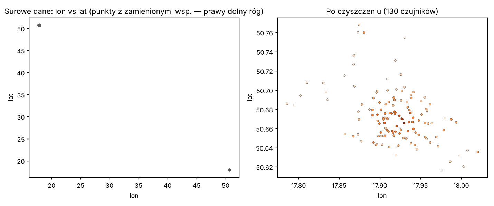
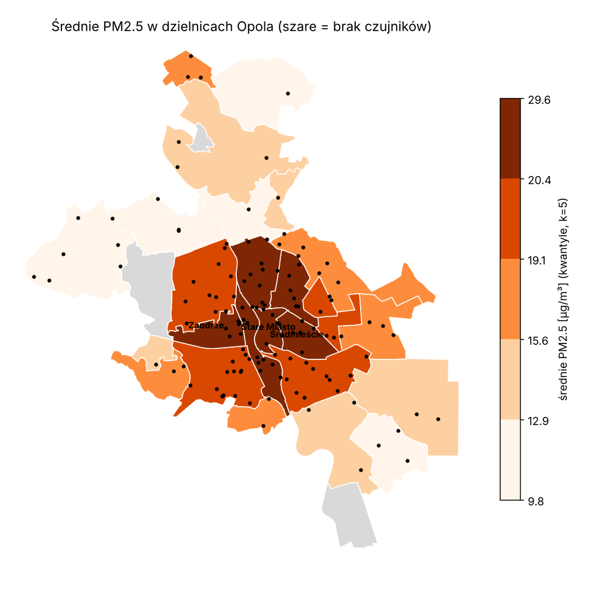
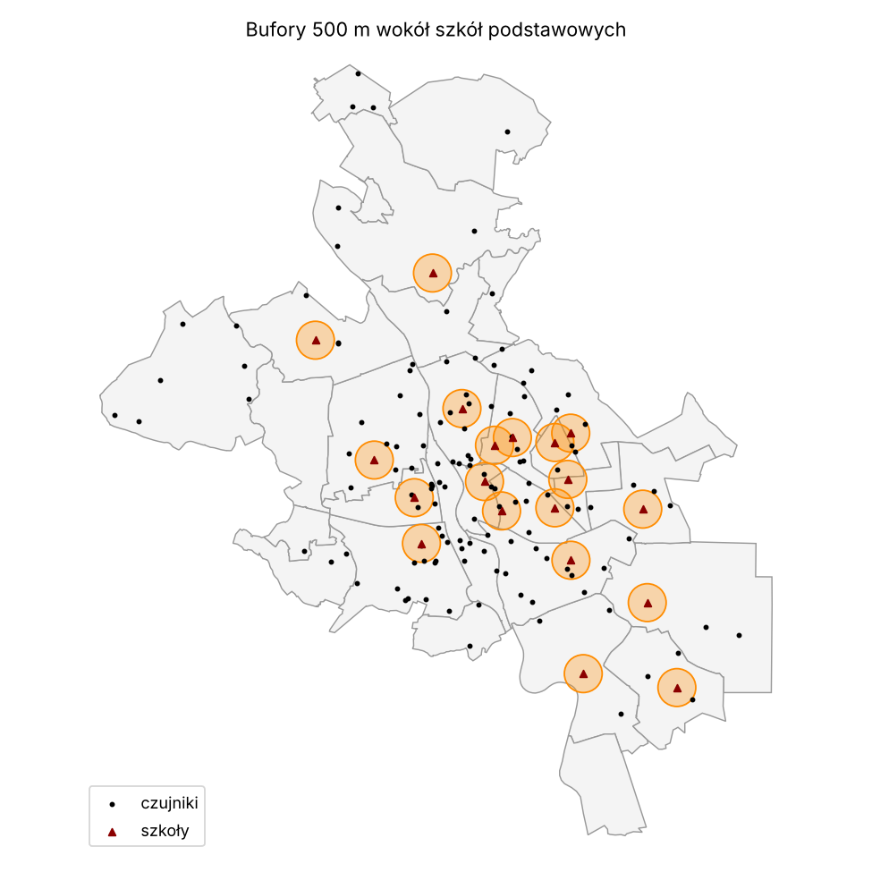

# Lab GeoPandas – PM2.5 w Opolu

Kod: `lab_geopandas.ipynb` · Dane: `dane/` · Uruchomienie: `pip install -r requirements.txt`, potem `jupyter lab`

## Cel
Na podstawie odczytów PM2.5 z czujników (plik CSV z błędami) odpowiedzieć na dwa pytania:
1. Które dzielnice Opola mają najgorsze powietrze?
2. Jak jest w pobliżu szkół podstawowych?

## Instrukcja krok po kroku

**0. Przygotowanie środowiska**
```bash
mkdir lab_geo && cd lab_geo          # pliki od prowadzącego wrzuć do podfolderu dane/
python -m venv .venv
source .venv/bin/activate            # Windows: .venv\Scripts\activate
pip install geopandas rasterio matplotlib mapclassify folium jupyter
jupyter lab                          # utwórz notatnik lab_geopandas.ipynb
```

**1. Wczytaj CSV i obejrzyj dane:** `pd.read_csv`, potem `describe()`, `isna().sum()` i `duplicated().sum()`.

**2. Wyczyść dane:** `drop_duplicates()`, następnie `dropna(subset=["lat","lon"])`, zamiana lat/lon przez `.to_numpy()` i usunięcie wierszy z `pm25 < 0`.

**3. Utwórz GeoDataFrame:** `gpd.GeoDataFrame(df, geometry=gpd.points_from_xy(df.lon, df.lat), crs="EPSG:4326")`.

**4. Przelicz do układu metrycznego:** `sensors.to_crs("EPSG:2180")`.

**5. Wczytaj dzielnice i policz powierzchnię:** `gpd.read_file(...)`, potem `.to_crs("EPSG:2180")` i `.area / 1e6`.

**6. Przypisz czujniki do dzielnic:** `gpd.sjoin(sensors_m, districts, predicate="within")`, a następnie `groupby("name")` i średnia `pm25`.

**7. Zrób mapę:** `summary.explore(column="pm25_mean", scheme="quantiles", k=5)`.

**8. Wyznacz bufory 500 m wokół szkół:** `schools.buffer(500)`, potem `sjoin` z czujnikami i średnia PM2.5.

**9. Zapisz wyniki:** `to_file("wyniki/pm25.gpkg", layer=..., driver="GPKG")` oraz GeoJSON w EPSG:4326.

Pełny kod każdego kroku jest w notatniku `lab_geopandas.ipynb`.

---

## 1. Czyszczenie danych

| Krok | Wiersze |
|---|---|
| dane wejściowe | 145 |
| usunięcie duplikatów | 140 |
| usunięcie wierszy bez współrzędnych | 134 |
| poprawienie zamienionych lat/lon (3 wiersze) | 134 |
| usunięcie kodów błędu `pm25 = −999` | **130** |

Zamienione współrzędne poprawiliśmy, bo dane były kompletne, tylko w złych kolumnach. Wartości −999 usunęliśmy, bo to kod awarii czujnika, a nie pomiar.



## 2. Układ współrzędnych
EPSG:4326 podaje położenie w stopniach, a te nie nadają się do mierzenia odległości. Porównanie odległości Gdańsk–Zakopane:

| Układ | Odległość | Błąd |
|---|---|---|
| geodezyjna (rzeczywista) | 569,3 km | – |
| EPSG:2180 (PUWG 1992) | 568,9 km | −0,07 % |
| EPSG:3857 (Web Mercator) | 922,8 km | +62 % |

Dlatego wszystkie obliczenia wykonano w **EPSG:2180**. Opole ma 29 dzielnic i powierzchnię **148,8 km²**.

## 3. Najgorsze dzielnice
Każdy czujnik przypisano do dzielnicy złączeniem przestrzennym (`sjoin`, `within`). Uwzględniono tylko dzielnice z co najmniej 3 czujnikami.

| Dzielnica | PM2.5 [µg/m³] | Czujniki |
|---|---|---|
| Stare Miasto | **29,6** | 3 |
| Śródmieście | 26,8 | 7 |
| Zaodrze | 22,5 | 6 |
| Nadodrze | 22,4 | 9 |
| Zakrzów | 20,8 | 13 |

Trzy dzielnice nie mają żadnego czujnika: Bierkowice, Borki i Grotowice.



## 4. Szkoły
Wokół każdej z 19 szkół wyznaczono bufor 500 m.

| | 500 m | 1500 m |
|---|---|---|
| szkoły z czujnikiem w pobliżu | 11 / 19 | 19 / 19 |
| średnie PM2.5 przy szkołach | **22,3 µg/m³** | 21,5 µg/m³ |
| pokrycie powierzchni miasta buforami | 9,5 % | 50,4 % |

Średnia dla całego miasta wynosi 18,9 µg/m³. Najgorsze wyniki mają szkoły w centrum: PSP nr 1 (30,7) i PSP nr 21 (30,4).



## 5. Zapis
Wyniki zapisano do `wyniki/pm25.gpkg` (warstwy `districts` i `sensors`, EPSG:2180) oraz do `wyniki/pm25_districts.geojson` (EPSG:4326, do zastosowań webowych).

## Wnioski
- Najgorsze powietrze jest w centrum (Stare Miasto, Śródmieście), najlepsze na obrzeżach.
- Szkoły leżą głównie w centrum, więc powietrze przy nich jest o ok. 18 % gorsze od średniej miejskiej.
- 8 szkół i 3 dzielnice nie mają czujnika w pobliżu, więc sieć pomiarową warto tam zagęścić.
- Odległości, powierzchnie i bufory trzeba liczyć w układzie metrycznym (EPSG:2180). Bufor 500 policzony w EPSG:4326 miałby promień 500 stopni zamiast 500 metrów.

Dane: OpenStreetMap (ODbL), odczyty PM2.5 syntetyczne.
